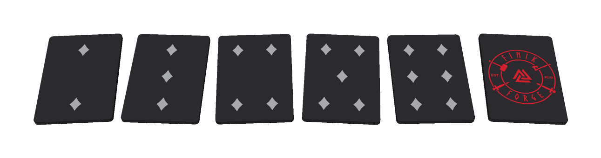
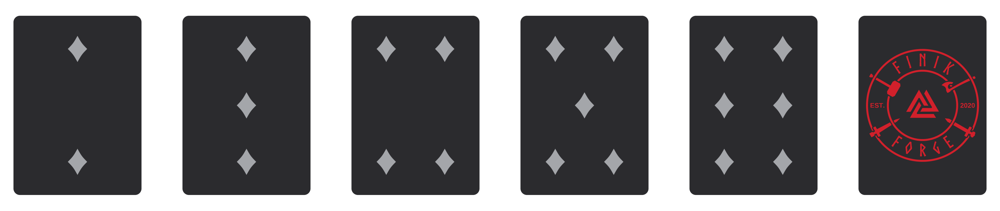
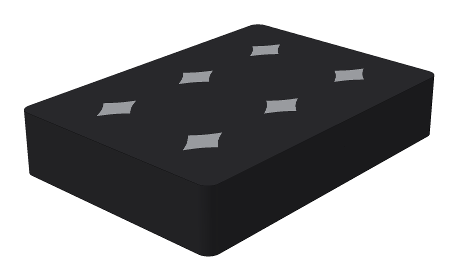

# Card Trainers

A 3D-printed set of **cardistry trainers**: five solid packets that stack into one 17 mm deck. They're for practising cuts, pivots and packet flourishes without spilling, bending or wearing out real cards.

Each packet is a poker-size card, 3.4 mm thick. The front shows the 2 to 6 of diamonds and the back shows the FINIK FORGE logo. Both designs are inlaid flush in a second and third colour, so the faces stay flat and the packets slide cleanly over each other.

<p align="center"></p>

## At a glance

| | |
|---|---|
| **Size** | 63.5 × 88.9 mm (poker size), 3.2 mm (1/8") corner radius |
| **Thickness** | 3.4 mm per packet, which is 17 layers at 0.2 mm. Five packets stack to 17 mm, the thickness of a new 54-card deck |
| **Colours** | 3: body black, logo red, pips gray. Each design is 3 layers (0.6 mm) deep |
| **Printer** | Any multi-material printer. The plate is laid out for a 256 × 256 mm bed (Bambu X2D) |
| **Supports** | None |
| **Source** | One parametric Python script builds every card and writes the 3MF |

<p align="center"></p>

<p align="center"></p>

## Printing

Open `stl/trainers.3mf` in Bambu Studio. It holds all five trainers on one plate. Each trainer is one object with three parts, with the filaments already assigned:

| Filament slot | Part | Colour |
|---|---|---|
| 1 | Body | Black |
| 2 | Logo (back) | Red |
| 3 | Pips (front) | Gray |

Map the three slots to your AMS spools and slice. The files carry slot numbers, not colours, so any three colours work.

- **Layer height:** 0.2 mm, including the first layer, so each packet comes out exactly 17 layers thick.
- **Orientation:** pips up, as laid out. The logo prints mirrored against the build plate, so it reads correctly when you flip the card. A smooth plate gives a glossy back; a textured plate gives a matte, grippier back.
- **Colour changes:** no layer uses more than two colours: the bottom 3 layers are black and red, and the top 3 are black and gray. On a two-nozzle printer like the X2D, that's a single filament swap per plate.
- **Elephant's foot:** keep elephant's-foot compensation on (Bambu's default is 0.15 mm). A flared bottom edge would make the packets catch on each other.
- **Ironing:** leave it off, or test it on one card first. On a two-colour top it can smear the gray into the black.
- **Fine detail:** the thinnest strokes are the EST. and 2020 text on the logo, about 0.46 mm wide. That's one 0.4 mm nozzle line; check those layers in the slicer preview.

## Customising

Everything is set by the constants at the top of `source/trainers.py`:

| Constant | Default | What it does |
|---|---|---|
| `CARD_W`, `CARD_H`, `CORNER_R` | 63.5, 88.9, 3.2 | Card size. Use 57 × 89 for bridge size |
| `LAYER`, `LAYERS` | 0.2, 17 | Packet thickness = `LAYER × LAYERS`. Measure your own deck and divide by 5 |
| `INK_LAYERS` | 3 | How deep each colour inlay goes |
| `RANKS` | 2 to 6 | Which cards to make, one packet each |
| `PIP`, `PIP_W`, `PIP_COL`, `PIP_ROW` | 13, 9.6, 14.5, 28 | Diamond size and spacing |
| `BACK` | `"logo"` | `"logo"` uses `art/finikforge_logo.svg`; `"valknut"` uses just the woven valknut |
| `LOGO_D` | 56 | Logo diameter |
| `FIL_BODY`, `FIL_LOGO`, `FIL_PIPS` | 1, 2, 3 | Filament slots for each part |

To use your own artwork on the back, replace `art/finikforge_logo.svg`. Any SVG with filled paths works; it's scaled to `LOGO_D` and centred.

## Building

```bash
pip install -r requirements.txt
python3 source/trainers.py   # writes stl/trainers.3mf
python3 source/render.py     # writes images/
```

## License

- **Code** (`source/`): MIT, see [LICENSE](LICENSE).
- **Models and images** (`stl/`, `images/`): CC BY-SA 4.0, see [LICENSE-MODELS](LICENSE-MODELS).
- **FINIK FORGE logo:** not covered by either license; all rights reserved.
